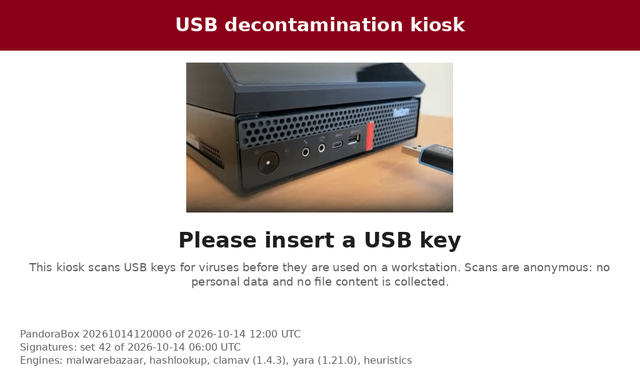
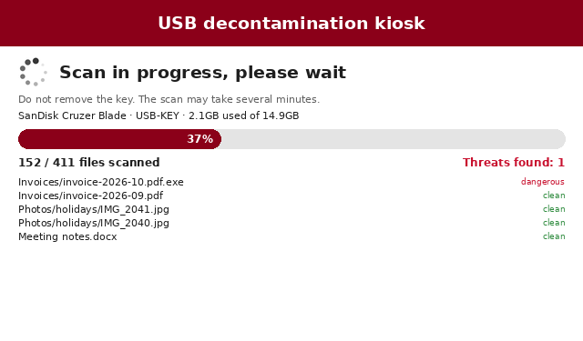
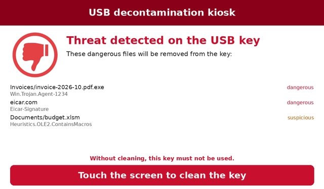
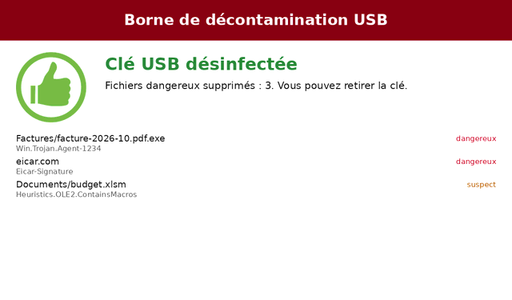

# PandoraBox

[](https://github.com/sourcentis/pandora-box/actions/workflows/ci.yml)


[English](README.md) | **Français**

### Introduction

Les clés USB restent une porte d'entrée courante dans des systèmes d'information par ailleurs bien protégés : elles passent d'une organisation à l'autre, se branchent sur des ordinateurs non gérés et entrent dans des réseaux isolés. Une borne de décontamination, ou « station blanche », les vérifie avant qu'elles n'atteignent un poste de travail.

**PandoraBox** est une borne libre de décontamination de clés USB. L'utilisateur insère une clé, la borne analyse chaque fichier avec plusieurs moteurs de détection, affiche sur son écran tactile les fichiers dangereux trouvés, et les supprime quand l'utilisateur touche l'écran. Elle tourne sur un petit ordinateur reconditionné, fonctionne sans réseau, et est distribuée sous forme d'image système complète et durcie.

PandoraBox veut être une alternative **libre, auditable et durcie** aux bornes commerciales, pour les environnements sensibles comme la santé, l'industrie et les administrations. C'est une réécriture complète de la première version de PandoraBox, sans dépendance à Pandora (CIRCL).

📚 [Lire la documentation](https://sourcentis.github.io/pandora-box/) (en anglais) |
🗺️ [Feuille de route](ROADMAP.md) |
🔍 [Code source](src/pandora_box/)

## 🌟 **Fonctionnalités**

- 🔍 **Plusieurs moteurs de détection :** empreintes de logiciels malveillants connus ([MalwareBazaar](https://bazaar.abuse.ch/)), fichiers connus ([CIRCL Hashlookup](https://www.circl.lu/services/hashlookup/)), [ClamAV](https://www.clamav.net/), [YARA-X](https://virustotal.github.io/yara-x/) avec les règles [YARA Forge](https://yarahq.github.io/), et des heuristiques pour les programmes déguisés en documents et les PDF contenant du JavaScript.
- 🚫 **Échec sûr (« fail closed ») :** un fichier qui n'a pas pu être entièrement analysé (archive chiffrée, limite dépassée, erreur d'un moteur) n'est jamais déclaré sain.
- 👆 **Interface tactile, sans bouton :** progression de l'analyse, fichiers dangereux listés avant leur suppression, un appui n'importe où sur l'écran pour nettoyer la clé.
- 🎨 **Personnalisable :** l'organisation choisit son logo, ses couleurs, les textes et la langue de l'interface.
- 🗄️ **Quarantaine et rapports :** les fichiers dangereux sont copiés sur la borne avant leur suppression, et chaque analyse produit un rapport JSON.
- 🛡️ **Image durcie :** système de fichiers racine en lecture seule protégé par dm-verity, Secure Boot, USBGuard contre les périphériques BadUSB, aucun compte ni session, chaque moteur dans un bac à sable sans réseau.
- ✍️ **Mises à jour signées :** les jeux de signatures et les mises à jour du système sont signés, installés depuis une clé USB sur les bornes hors ligne, ou téléchargés par un canal dédié ; mises à jour A/B du système avec retour automatique à la version précédente.
- 🧰 **Maintenance sans session :** une clé USB signée récupère les journaux de la borne.

## 🖼️ **Captures d'écran**

### ⏳ **Attente d'une clé, analyse en cours**

[](docs/images/interface-ready.png) [](docs/images/interface-scanning.png)

### ☣️ **Menaces trouvées, clé nettoyée**

[](docs/images/interface-threats.png) [](docs/images/interface-cleaned.png)

## 🛠️ **Technologies**

- **Borne :** Python 3.11+, avec [Pillow](https://python-pillow.org/) pour dessiner l'interface directement dans le framebuffer (sans serveur d'affichage ni navigateur)
- **Moteurs :** ClamAV (clamd), YARA-X, bases MalwareBazaar et Hashlookup, libmagic
- **Système :** image Debian 13 construite avec [mkosi](https://github.com/systemd/mkosi), systemd-boot, Secure Boot, dm-verity, systemd-sysupdate, USBGuard, bubblewrap, nftables
- **Tests :** pytest, et un test de bout en bout de toute l'image dans une machine virtuelle QEMU/KVM

## 💻 **Matériel**

- **Ordinateur :** Lenovo ThinkCentre Tiny reconditionné (validé : M720q, Core i5-9400T), 2 Go de mémoire au minimum
- **Écran :** Waveshare 7 pouces HDMI LCD (C), écran tactile capacitif, 1024x600
- **Boîtier :** imprimé en 3D, dans le dossier [3D](3D/) (CERN-OHL-S v2)

Voir le [guide du matériel](https://sourcentis.github.io/pandora-box/hardware/), et le [guide d'installation](https://sourcentis.github.io/pandora-box/install/) pour les réglages du BIOS.

## 📦 **Installation**

PandoraBox est distribuée sous forme d'image système complète, construite avec Docker uniquement :

```bash
git clone https://github.com/sourcentis/pandora-box.git
cd pandora-box
image/build.sh                                  # construit l'image
image/build-test.sh && image/vm.sh test         # facultatif : la teste dans une machine virtuelle
```

Écrivez ensuite `image/mkosi.output/pandora-box.raw` sur le disque de la borne, enrôlez la clé Secure Boot et installez un jeu de signatures depuis une clé USB. Chaque étape est décrite dans la documentation : [construction de l'image](https://sourcentis.github.io/pandora-box/build/), [test avec QEMU](https://sourcentis.github.io/pandora-box/vm/), [installation initiale](https://sourcentis.github.io/pandora-box/install/), et la maintenance : [signatures](https://sourcentis.github.io/pandora-box/signatures/), [mises à jour du système](https://sourcentis.github.io/pandora-box/update/), [journaux](https://sourcentis.github.io/pandora-box/logs/).

Pour travailler sur le code, voir le [guide de développement](https://sourcentis.github.io/pandora-box/development/).

## 📜 **Feuille de route**

Le projet avance par phases : moteur d'analyse, image durcie, interface de la borne, analyse avancée, gestion d'un parc, assurance et conformité. Suivez son avancement dans la [feuille de route](ROADMAP.md).

## 🤝 **Contribuer**

Les contributions sont les bienvenues ! Voir [CONTRIBUTING.md](CONTRIBUTING.md). Pour signaler une vulnérabilité, suivez [SECURITY.md](SECURITY.md).

## 📄 **Licence**

PandoraBox est un logiciel libre, sous [licence publique générale GNU v3.0](LICENSE). Le boîtier du dossier [3D](3D/) est sous licence CERN-OHL-S v2.
