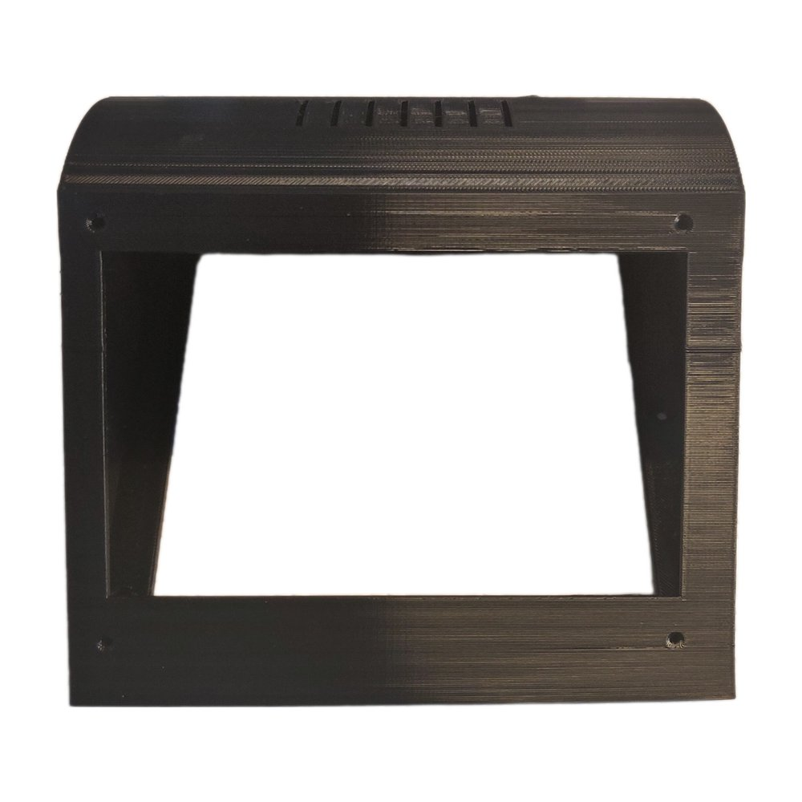
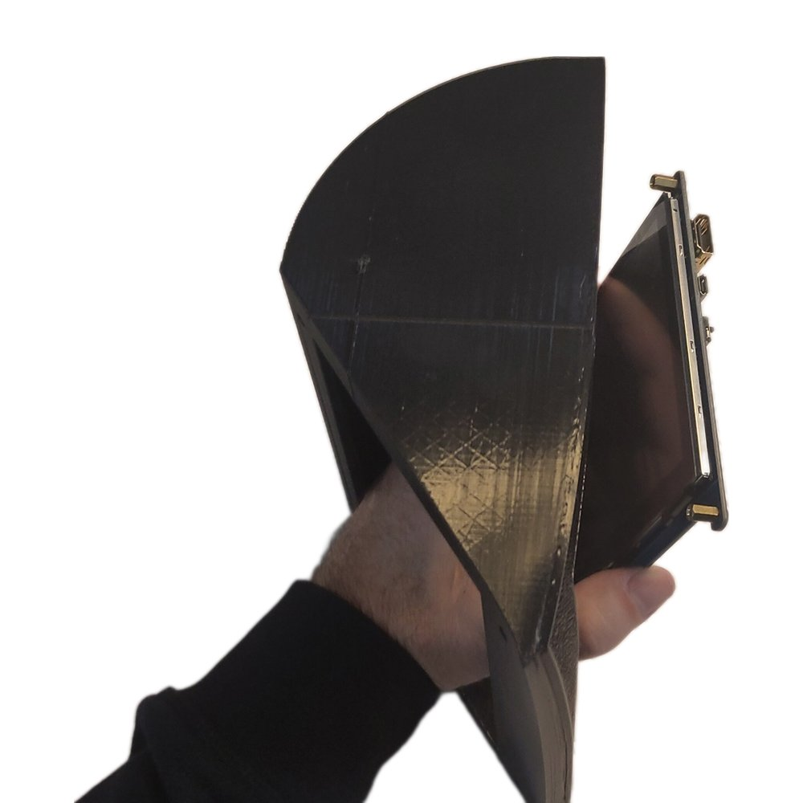
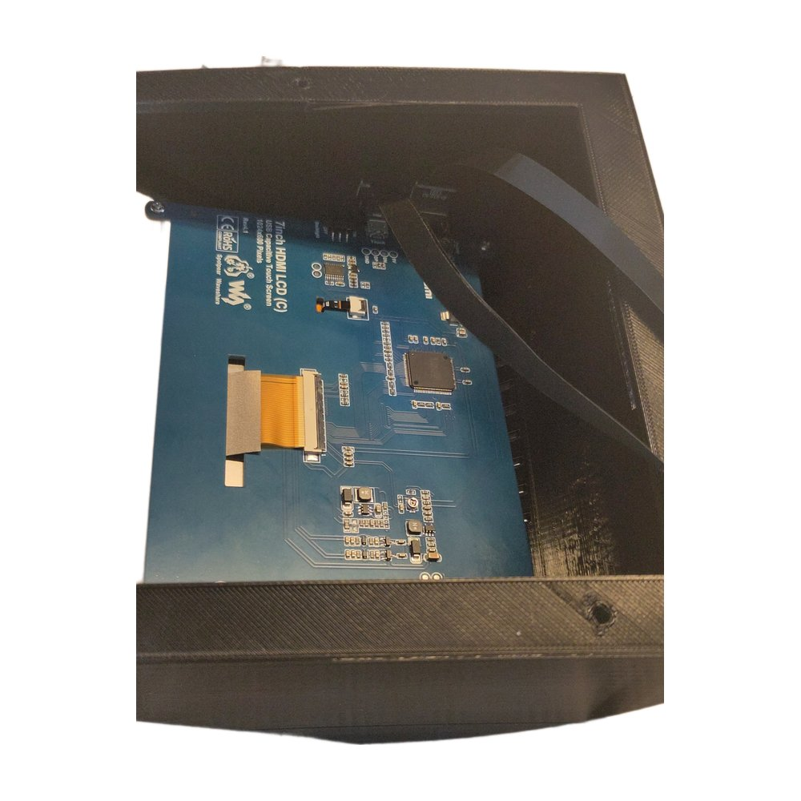
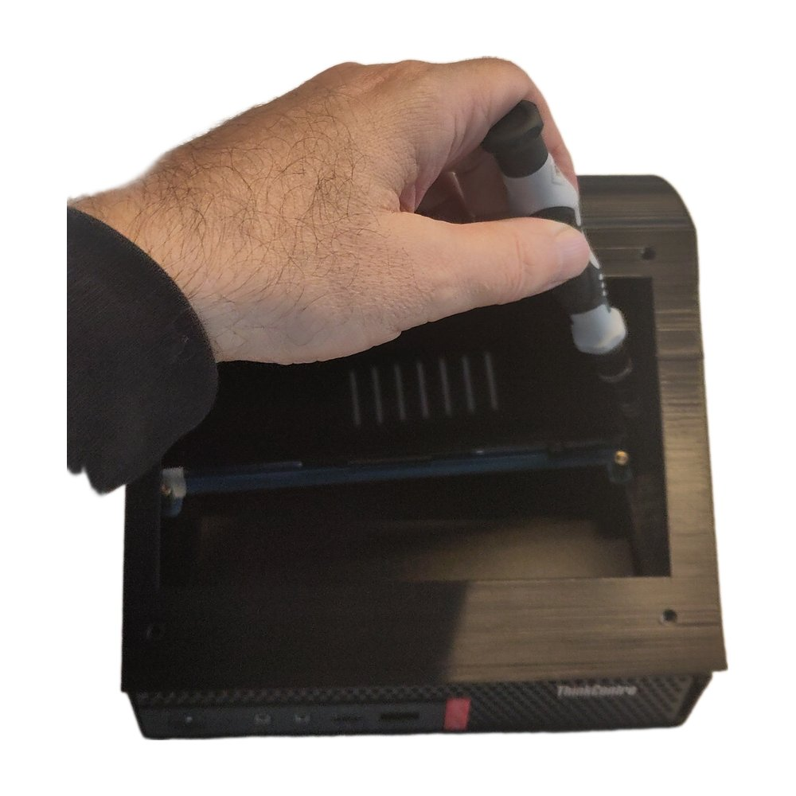
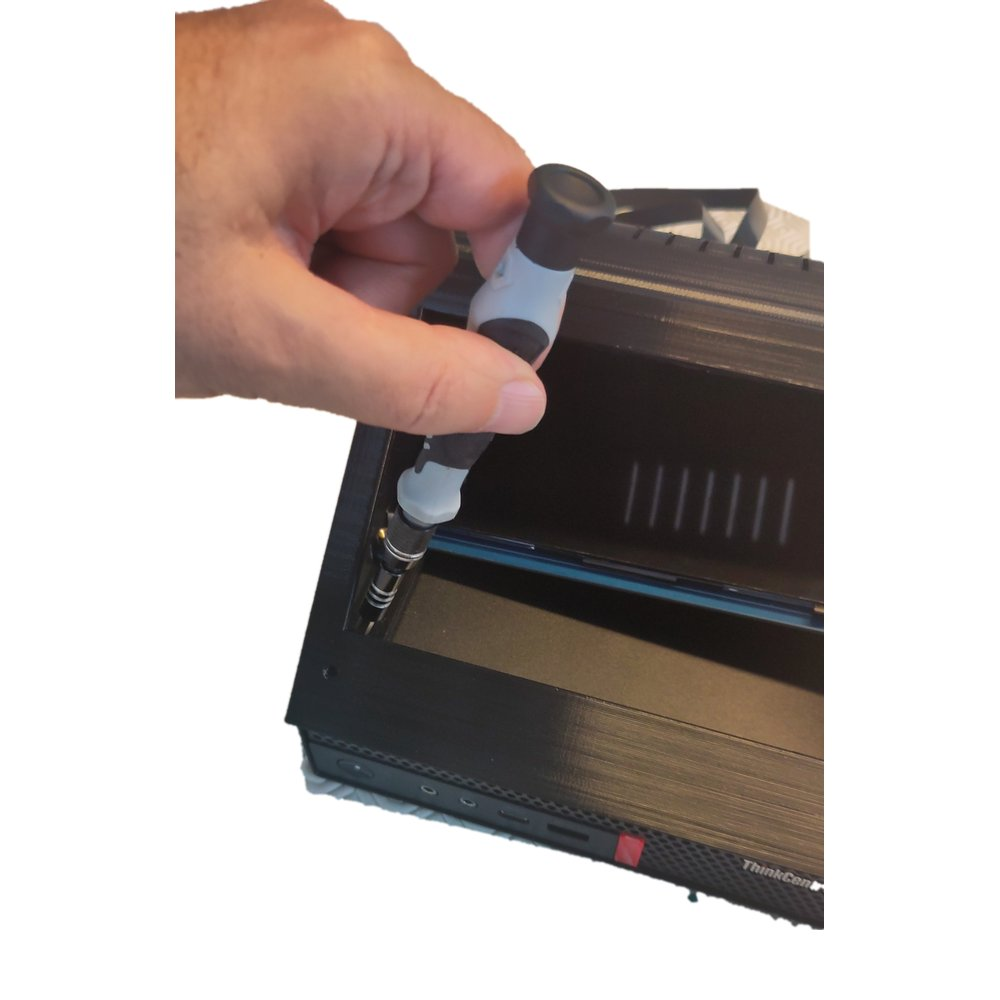
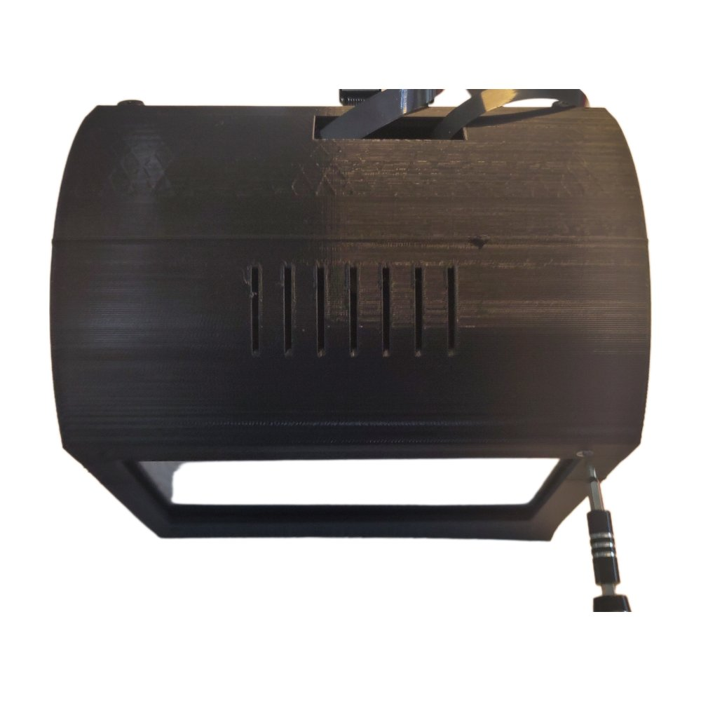
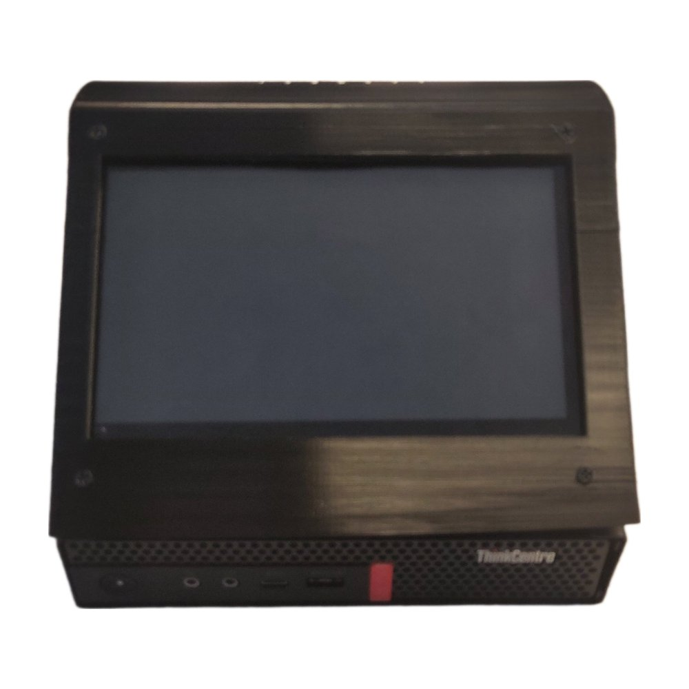

# Assemblage de la borne

Cette page décrit l'assemblage d'une borne : l'écran tactile dans le boîtier
imprimé en 3D, le boîtier sur le support de l'ordinateur, puis l'ordinateur
dans son support. Le matériel validé est décrit dans [Matériel](hardware.md).

{ width="400" }

## Matériel nécessaire { #parts }

| Pièce | Quantité | Remarque |
|---|---|---|
| Boîtier imprimé en 3D | 1 | Modèle dans [3D/](https://github.com/sourcentis/pandora-box/tree/main/3D) (voir [Boîtier](hardware.md#enclosure)) |
| Écran tactile Waveshare 7 pouces HDMI LCD (C) | 1 | |
| Câble plat HDMI FPV mâle vers le haut 90D HDMI mâle HDTV FPC | 1 | Image de l'écran |
| Câble plat micro USB 2.0 mâle vers micro USB mâle coudé à 90 degrés vers le haut | 1 | Contrôleur tactile et alimentation de l'écran |
| Lenovo ThinkCentre M720q Tiny | 1 | |
| Lenovo ThinkCentre Tiny VESA Mount II (4XF0N03161) | 1 | Support métallique du ThinkCentre, le boîtier se visse sur ses trous VESA |
| Vis M3x8 à tête cruciforme (Phillips) | 7 | 4 pour l'écran, 3 pour le support |
| Tournevis cruciforme | 1 | Long et fin, pour atteindre les vis au fond du boîtier |

Les câbles coudés passent dans le peu d'espace entre l'écran et le dos du
boîtier.

## 1. Insérer l'écran { #screen }

Avant de commencer, mettre sur marche l'interrupteur de rétroéclairage au dos
de l'écran : il n'est plus accessible une fois la borne assemblée.

Insérer l'écran dans le boîtier par l'ouverture inférieure.

{ width="400" }

## 2. Connecter les câbles { #cables }

Brancher les câbles HDMI et USB coudés sur l'écran, à l'intérieur du boîtier,
et les faire sortir par l'ouverture à l'arrière du boîtier.

{ width="400" }

## 3. Visser le boîtier sur le support { #enclosure }

Poser le boîtier sur le Tiny VESA Mount II et le fixer avec 3 vis. La
quatrième vis, à l'intérieur, n'est pas accessible et reste vide.

| | |
|---|---|
|  |  |

## 4. Visser l'écran { #screen-screws }

Fixer l'écran au boîtier avec les 4 vis restantes, une par coin. L'opération
est délicate : commencer par un coin sans serrer, puis placer les autres, en
basculant au besoin le boîtier sur le côté ou vers l'avant pour aligner les
trous. Serrer les 4 vis une fois toutes en place.

{ width="400" }

## 5. Installer le ThinkCentre { #computer }

Glisser le ThinkCentre dans le Tiny VESA Mount II, face avant visible, puis brancher
les câbles HDMI et USB à l'arrière de l'ordinateur.

{ width="400" }

La borne est prête pour l'[installation initiale](install.md).
