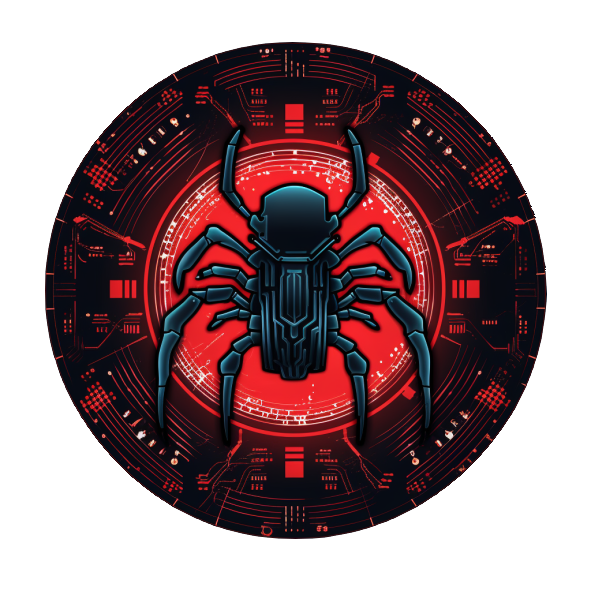

# Introduction

{ width="400" }

**PandoraBox** is an open source USB decontamination kiosk, a "sheep-dip
station": a user inserts a USB key, the kiosk scans every file with several
detection engines, shows the dangerous files it found, and removes them when
the user touches the screen. It is a complete rewrite of the first version of
PandoraBox, without dependency on Pandora (CIRCL).

## Objective

USB keys remain a common way into information systems that are otherwise
well protected: shared between organizations, used on unmanaged computers,
plugged into isolated networks. A decontamination kiosk checks them before
they are used on a workstation.

PandoraBox aims to be a **free, auditable and hardened** alternative to
commercial kiosks, for sensitive environments: healthcare, industry, public
administration. It runs on a refurbished small computer with a touch screen,
and works without network.

## How it works

- **Several engines**: known malicious hashes (MalwareBazaar), known files
  (CIRCL Hashlookup), ClamAV, YARA-X rules (YARA Forge) and structure
  heuristics (programs disguised as documents, PDF with JavaScript). See
  [Detection engines](engines.md).
- **Fail closed**: a file that could not be fully scanned (encrypted archive,
  limit exceeded, engine error) is never reported as clean. Every partition
  of a key is scanned; a partition that cannot be (encrypted, unknown
  filesystem) makes the key not verified.
- **Nothing is removed without the user**: the dangerous files are listed on
  the screen, copied to the quarantine of the kiosk, then removed from the key
  only after a touch of the screen.
- **Traceability**: every scan produces a structured JSON report.

## Guiding principles

- **Minimal, hardened image**: the system contains only what is needed to
  scan. Read-only root filesystem with dm-verity, Secure Boot, USBGuard, no
  account and no login. See [Image and installation](image.md).
- **Defense in depth**: the USB key is hostile, and the analyzers are assumed
  to be compromisable. Each engine runs in its own sandbox, without network.
- **Offline by default**: no network is needed to scan; signatures and system
  updates come on signed USB keys, or through a dedicated online channel. See
  [Signature updates](signatures.md).
- **Customizable**: the organization sets its logo, colors and texts of the
  interface. See [Interface](interface.md).

## Documentation

| Page | Content |
|---|---|
| [Hardware](hardware.md) | Validated computer and screen, BIOS settings, enclosure |
| [Image and installation](image.md) | Build, install, update and maintain the kiosk image |
| [Interface](interface.md) | Screens of the kiosk, theme of the organization |
| [Configuration](configuration.md) | Every setting of `pandora-box.toml` |
| [Detection engines](engines.md) | Engines, verdict policy, scan report |
| [Signature updates](signatures.md) | Signed signature sets, offline and online updates |
| [Development](development.md) | Run the kiosk from the sources, tests |

The progress of the project is followed in the
[roadmap](https://github.com/dbarzin/pandora-box/blob/main/ROADMAP.md).
PandoraBox is free software, licensed under the
[GNU General Public License v3.0](https://github.com/dbarzin/pandora-box/blob/main/LICENSE).
